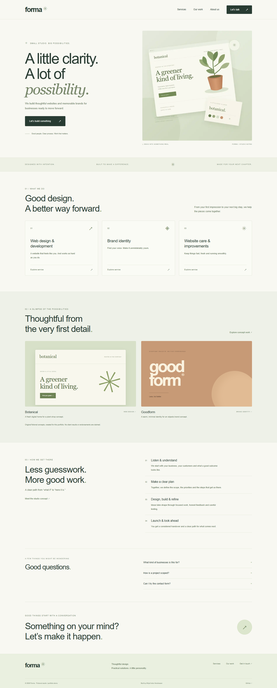

# Forma — Next.js Service Business

A small business website portfolio by **Afrijal Indra Hendrawan**. Forma is a fictional independent web and branding studio. Built with Next.js App Router, React, semantic HTML and custom responsive CSS.



## Run locally

Node.js 22.12+ and npm are required.

```sh
npm ci
npm run dev
```

Open http://127.0.0.1:3004. On Windows use `npm.cmd` if PowerShell blocks npm scripts, or run `start-website.bat` after installing dependencies.

For a production build:

```sh
npm run build
npm start
```

## Pages and behavior

- Home: original workspace illustration, service previews, concept work, process, FAQ and contact links.
- Services: overview plus three statically generated detail pages: web design, brand identity and website care.
- Work: two explicitly fictional original concept studies, Botanical and Goodform.
- About: studio concept and transparent portfolio authorship.
- Contact: client/server validation, consent, error recovery and duplicate-submit guard.
- Custom 404, page-specific metadata, social preview, icon, robots and sitemap.
- Responsive mobile navigation, keyboard focus, skip link, native FAQ disclosure and reduced-motion support.

**Contact is a demo.** A successful response confirms validation only; no email is sent and no inquiries are saved. Do not use real personal data. The API validates JSON, request size and same-origin submissions. This is not a production lead-management backend; add an email provider, shared rate limiting and appropriate abuse protection before public use.

## Design

Original warm neutral and sage art direction. All visible illustration is repository-owned SVG/CSS, not a stock photo or client asset. `public/studio.svg` is the editable illustration source; PNG is the high-resolution baseline, WebP the optimized production input. System fonts avoid remote font requests. Marketing examples and timelines are illustrative; no customer endorsements, invented results or real agency history are claimed.

## Test

```sh
npm test
npm run build
npx playwright install chromium
# Start the production server in another terminal:
npm start
npm run test:browser
```

For an installed Chrome, set `CHROME_PATH` to its executable before the browser test. Tests cover field boundaries, malformed input, API status/error behavior, navigation, service pages, 404, form submission, mobile layouts and sitemap. See [verification](docs/TEST-RESULTS.md). GitHub Actions runs the same test/build/browser checks on Node 22.

## Performance case study

See [PERFORMANCE.md](docs/PERFORMANCE.md) for measured before/after evidence. `/performance-baseline` renders the same homepage with the original unoptimized PNG, while `/` uses a resized WebP through Next Image. The baseline is an explicit controlled comparison, not a fabricated historical client issue. It is noindexed and omitted from the sitemap/navigation.

Reproduce against a **production** server with installed Chrome:

```sh
node scripts/performance.mjs
```

The script runs Lighthouse three times per version with matching mobile simulation and writes raw JSON plus a compact summary. Lighthouse scores are local lab estimates, not real-user measurements or a guaranteed ranking outcome. The noindexed baseline is not suitable for SEO score comparisons.

## Hosting configuration

Set `SITE_URL` to the real deployment origin **before building** to generate correct absolute sitemap/social URLs. The default is localhost for local use. This repository has not been deployed to a public website. The contact route needs a Node-compatible Next.js host; do not use static HTML export for the full app.

## Structure

`app/`: pages, metadata routes and contact API. `components/`: shared header/footer, homepage and form. `lib/contact.mjs`: shared pure validation. `lib/services.js`: service content. `tests/`: unit/API and browser checks. `scripts/performance.mjs`: reproducible lab comparison.

The owner selected requirements; Codex assisted with design, implementation and verification. This is original portfolio work, not a paid client engagement. MIT licensed.
